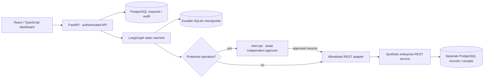

# Architecture and tradeoffs

## State machine

`plan → permission → approval → execute → END`. Planning errors terminate in `needs_information`; permission failure terminates in `denied`. Protected actions invoke LangGraph `interrupt()` and resume via `Command(resume=...)`. Rejection terminates without entering the executor. Each request ID is a server-generated checkpoint thread ID. Frontend code cannot supply graph state, thread identifiers for new requests, role claims, tool URLs or approval flags.

SQLite checkpoints are separate from application data to keep the demo simple and restartable. The checkpoint volume must be backed up alongside PostgreSQL. This deployment intentionally uses one API worker and a process lock to serialize state mutations. It is not a distributed queue architecture. Before horizontal scaling, use PostgreSQL checkpoint storage, database-backed leases and a transactional outbox for audit/approval decisions. Audit events and checkpoints currently span separate transactions; a crash can leave a repeated or incomplete audit event, but service idempotency prevents replayed mutations.

## Tool safety

Pydantic validates an allowlisted `Proposal`. The local deterministic planner handles the documented English patterns and structured JSON. It is not a general-purpose language model and does not claim broad language understanding. Injection keyword detection is defense in depth; authorization and fixed tool endpoints enforce safety even when wording bypasses the heuristic. New integrations must implement server-side policy independently of model outputs.

Every operation has a stable server-issued idempotency key. The service stores a payload hash and response in the same SQL transaction as its mutation. Conflicting key reuse returns HTTP 409. Network timeouts are retried once; explicit retries retain the approved proposal and operation key. Schema-invalid responses and HTTP errors are recorded as failures. No arbitrary commands or URL fetching are implemented.

## Identity and data boundaries

Three environment-defined bearer credentials map to distinct server-side identities. Requesters see their own requests; approvers see the queue and cannot approve their own requests. Viewers may read synthetic ticket status but cannot mutate records. Service credentials are never sent to browsers. The synthetic service represents a shared IT workspace, not per-ticket tenant isolation. This is documented development authentication, not a production identity system.

## Data and deployment

SQLAlchemy creates the initial schema on startup. No upgrade migration framework is claimed in this initial version. Two PostgreSQL services keep agent records and enterprise service records separate. Docker runs application processes as non-root and exposes API/UI only on loopback. UI uses Radix dialogs, responsive CSS, Tailwind integration and real API records for metrics. The SDK's `httpx` transport is replaced only in unit/evaluation tests; Docker/browser verification traverses actual HTTP sockets.

## Acceptance evidence

See [acceptance contract](docs/ACCEPTANCE.md), [verification](docs/VERIFICATION.md), and [category evaluation](docs/EVALUATION.md). Official LangGraph interrupt/persistence behavior: https://reference.langchain.com/python/langgraph/types/interrupt .
