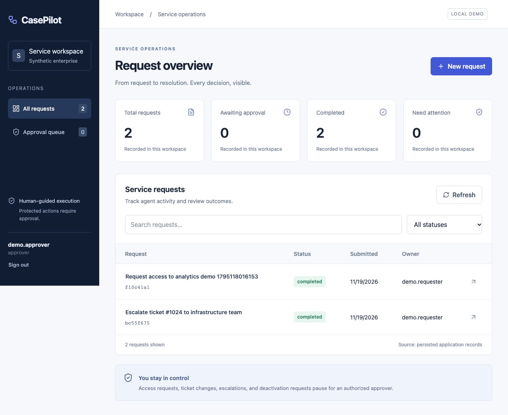
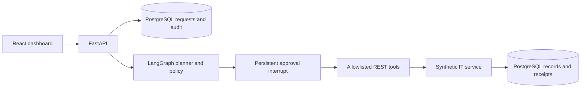

# CasePilot — Human-Guided Service Agents

A working service-operations application in which a stateful agent proposes IT actions, pauses for an independent human decision, and resumes an authenticated REST tool call. All records are synthetic. This portfolio project demonstrates durable orchestration and safety boundaries; it is not a production identity or ITSM product.



## What it solves

Service agents need more than a chat response: validated operations, explicit permission boundaries, approvals that survive restarts, and a reliable record of what actually happened. CasePilot implements that path end to end.

- Natural-language and structured JSON requests; filterable request dashboard and audit timeline.
- Genuine LangGraph transitions and persistent approval interrupts.
- Separate REST service implementing ticket creation, retrieval, update, escalation, access requests, status checks and deactivation requests.
- Role enforcement, self-approval prevention, transactional tool idempotency and bounded retries.
- Exactly 200 labeled synthetic evaluation cases, plus API/security/restart tests and browser verification.
- Local deterministic planner, with no paid API or AWS account required.

## Stack and architecture

Python 3.12, FastAPI, Pydantic, SQLAlchemy, PostgreSQL 16, LangGraph, SQLite checkpoint storage, httpx, React 19, TypeScript, Vite, Tailwind and Radix UI. pytest, Vitest/Testing Library and Playwright verify distinct layers.



Read [ARCHITECTURE.md](ARCHITECTURE.md) for state transitions, consistency limits and scaling tradeoffs.

## Quick start with Docker

Prerequisites: Git, Docker Engine/Desktop with Compose, available ports 5173 and 8000 (and 5433/5434 for databases).

```sh
git clone https://github.com/KartikP12s/casepilot-service-agents.git
cd casepilot-service-agents
cp .env.example .env
docker compose up -d --build --wait
```

Open http://localhost:5173. Sign in with `local-user-only`. Submit `Escalate ticket #1024 to the infrastructure team`. Inspect the proposed operation; it is awaiting approval. Sign out, sign in with `local-approver-only`, open Approval queue, inspect the request, enter a reason, and approve. The completed request displays its REST result and audit history. `local-viewer-only` demonstrates a read-only role. These are deliberately public development credentials, not secrets.

Ticket 1024 is seeded automatically in the synthetic service. No requests or adoption metrics are pre-populated. Counts come from persisted requests visible to the authenticated identity.

## Native development

Prerequisites: Python 3.12+, Node 22.12+ or compatible Node 24+, Docker for PostgreSQL.

```sh
python3 -m venv .venv
. .venv/bin/activate
pip install -r requirements.lock
pip install --no-deps -e .
cp .env.example .env
docker compose up -d db service-db
uvicorn casepilot.service:create_service --factory --port 8001
# In a second activated terminal:
uvicorn casepilot.main:create_app --factory --port 8000
# In a third terminal:
cd frontend
npm ci
npm run dev
```

Without an `.env` file, the backend defaults to isolated local SQLite databases under ignored `data/`; PostgreSQL is the standard Compose deployment. Never commit `.env` or data files.

## Configuration

See [.env.example](.env.example). `DATABASE_URL` and `SERVICE_DATABASE_URL` control application and synthetic-service storage. `CHECKPOINT_PATH` must point to durable writable storage. `SERVICE_URL` is operator-configured, never agent-controlled. `SERVICE_TOKEN` authenticates service calls. `USER_TOKEN`, `APPROVER_TOKEN`, `VIEWER_TOKEN` define demo identities. `CORS_ORIGIN` allows one explicit frontend origin. `TOOL_TIMEOUT` bounds HTTP calls. Compose overrides service URLs for container DNS.

## API and examples

Interactive OpenAPI documentation: http://localhost:8000/docs.

| Endpoint | Behavior |
|---|---|
| `GET /api/me` | Authenticated server-side identity |
| `GET /api/requests?status=awaiting_approval` | Authorized request listing |
| `POST /api/requests` | Submit `{ "text": "..." }` with `Idempotency-Key` |
| `GET /api/requests/{id}` | State and ordered audit events |
| `POST /api/requests/{id}/decision` | Approver decision `{ "approve": true, "reason": "Reviewed" }` |
| `POST /api/requests/{id}/retry` | Retry a failed tool with original approval and key |
| `GET /health` | Application/database readiness |

All `/api/` calls require `Authorization: Bearer <development credential>`. Example requests include `Create support ticket because my laptop cannot connect to Wi-Fi`, `Request access to analytics dashboard`, `Retrieve ticket 1024`, and `Prepare deactivation for account demo.alex`. Structured text can be JSON, e.g. `{"operation":"update_ticket","ticket_id":1024,"status":"closed"}`. Missing required fields yield `needs_information`.

## Verification

```sh
.venv/bin/ruff check backend tests scripts
.venv/bin/ruff format --check backend tests scripts
.venv/bin/pytest -q
.venv/bin/python scripts/evaluate.py
.venv/bin/pip-audit -r requirements.lock
cd frontend
npm ci
npm run build
npm test
npm audit --audit-level=high
npx playwright install chromium
npm run e2e
```

Browser tests require the Compose stack. They capture `docs/dashboard.png`, so screenshots can be reproduced from a fresh clone. From the repository root, `.venv/bin/python scripts/demo.py` runs the network approval workflow without a browser. Evaluation results are written to `docs/evaluation.json` and `docs/EVALUATION.md`; tests use isolated temporary databases and no paid services. Faults are deliberately injected only by the evaluation transport. See [actual verification results](docs/VERIFICATION.md).

## Security and limitations

Development tokens are shared demo identities. Before exposing the application, integrate OIDC with individually identified users, TLS, secret management, revocation and appropriate audit retention. API rate limits are per identity and process (120 requests/minute). SQL queries are parameterized. Strict schemas reject injected fields and the tool registry uses fixed URLs. The service API stays inside the Compose network. User request text can contain sensitive data; use only synthetic data and protect persisted volumes. Application logs omit raw prompts and credentials; audit records contain tool parameters intentionally for review.

Only one API worker is supported; graph state mutations are serialized in process. Checkpoint and audit transactions are not atomic. The planner supports documented patterns and rejects unknown tasks; no hosted LLM adapter is claimed. Browser operations run synchronously and refresh explicitly. Access and deactivation tools create synthetic requests rather than modify real enterprise accounts. There is no real customer adoption, production SLA or autonomous shell execution.

## Deployment and cleanup

Compose is a single-host reference deployment, not a managed cloud stack. Replace development credentials, provision persistent backups, use a reverse proxy with TLS, and integrate production authentication before public hosting. Do not scale API replicas without replacing the checkpoint/locking design. No cloud infrastructure is provisioned and no AWS costs are incurred by these instructions. A hosted deployment incurs compute, database, storage and network costs selected by the operator.

```sh
docker compose down       # preserve records
# Destructive reset, only when you want to remove demo data:
docker compose down -v
```

## Repository map and next steps

`backend/casepilot/`: API, schema, planner, graph and REST adapter. `frontend/`: dashboard and browser/component tests. `fixtures/`: 200 service cases. `tests/`: graph and security integration tests. `scripts/`: reproducible fixtures, evaluation and network demo. `docs/`: acceptance, verification and screenshots. `.github/workflows/`: CI builds, scans and end-to-end checks.

Future work: OIDC, PostgreSQL graph checkpointing, distributed task leases, audit outbox, schema migrations, and a schema-constrained hosted planner. These are future enhancements, not implemented capabilities.
